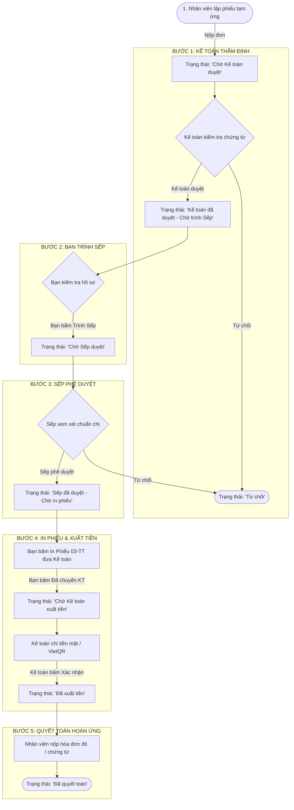

# HƯỚNG DẪN CẤU HÌNH APPSHEET: QUẢN LÝ & KÝ DUYỆT PHIẾU TẠM ỨNG
### (Quy trình thực tế: Nhân viên ➔ Kế toán duyệt ➔ Bạn trình Sếp ➔ Sếp duyệt ➔ Bạn in phiếu đưa Kế toán xuất tiền)

Tài liệu này chuẩn hóa 100% theo đúng quy trình vận hành thực tế tại doanh nghiệp của bạn.

---

## 📑 MỤC LỤC
1. [Sơ đồ Luồng duyệt 5 bước](#1-sơ-đồ-luồng-duyệt-5-bước)
2. [Phần 1: Cấu hình Bảng `PHIEU_TAM_UNG` & Danh mục Trạng thái](#phần-1-cấu-hình-bảng-phieu_tam_ung--danh-mục-trạng-thái)
3. [Phần 2: Thiết lập Phân quyền Người dùng theo Vai trò](#phần-2-thiết-lập-phân-quyền-người-dùng-theo-vai-trò)
4. [Phần 3: Cấu hình 6 Nút bấm Phê duyệt (Actions)](#phần-3-cấu-hình-6-nút-bấm-phê-duyệt-actions)
5. [Phần 4: Thiết lập Bộ lọc hiển thị (Slices) theo từng vai trò](#phần-4-thiết-lập-bộ-lọc-hiển-thị-slices-theo-từng-vai-trò)
6. [Phần 5: Thiết kế Giao diện người dùng (UX Views)](#phần-5-thiết-kế-giao-diện-người-dùng-ux-views)
7. [Phần 6: Tự động gửi Email thông báo qua Google Apps Script](#phần-6-tự-động-gửi-email-thông-báo-qua-google-apps-script)

---

## 1. SƠ ĐỒ LUỒNG DUYỆT 5 BƯỚC



---

## PHẦN 1: CẤU HÌNH BẢNG `PHIEU_TAM_UNG` & DANH MỤC TRẠNG THÁI

Vào mục **Data** ➔ Chọn bảng **`PHIEU_TAM_UNG`**:

### 1. Cột `TrangThai` (Trạng thái phiếu)
- **Type**: `Enum`.
- **Values** (Nhập đủ 7 giá trị theo quy trình):
  1. `Chờ Kế toán duyệt` *(Giá trị mặc định ban đầu)*
  2. `Kế toán đã duyệt - Chờ trình Sếp`
  3. `Chờ Sếp duyệt`
  4. `Sếp đã duyệt - Chờ in phiếu`
  5. `Chờ Kế toán xuất tiền`
  6. `Đã xuất tiền`
  7. `Đã quyết toán`
  8. `Từ chối`
- **Initial value**: `"Chờ Kế toán duyệt"`.
- **App Formula**: **ĐỂ TRỐNG HOÀN TOÀN**.
- **Editable?**: **TICK CHỌN (TRUE)**.
- **Để ẩn không cho nhân viên tự chọn trạng thái trong form tạo phiếu:**
  - Bấm vào biểu tượng ✏️ bên cạnh `TrangThai` ➔ Cuộn xuống ô **`Show?`** ➔ Dán:
    ```excel
    CONTEXT("ViewType") <> "Form"
    ```

### 2. Cột `SoTienTamUng` (Số tiền tạm ứng - Nhân viên tự nhập)
- **Type**: `Price`.
- **App Formula**: **ĐỂ TRỐNG**.
- **Editable?**: **TICK CHỌN (TRUE)** (để nhân viên tự điền số tiền xin).
- **Require?**: **TICK CHỌN (TRUE)**.
- **Valid_If**: `[_THIS] > 0`.
- **Type Details**: `Currency symbol`: `₫` hoặc `VND`, `Decimal digits`: `0`.

---

## PHẦN 2: THIẾT LẬP PHÂN QUYỀN NGƯỜI DÙNG THEO VAI TRÒ

Trong bảng **`DANH_MUC_NHAN_VIEN`**, thiết lập 3 vai trò chính:
1. **`KeToan`**: Bộ phận Kế toán (Duyệt thẩm định bước 1 & Xuất quỹ bước 5). Ví dụ: `ducvuongggnguyen@gmail.com`.
2. **`TruongBoPhan`** (hoặc `QuanLy`): Bạn ("Tôi") - Người tiếp nhận phiếu sau khi Kế toán duyệt để chuẩn bị trình Sếp và in phiếu. Ví dụ: `gnasche.ai@gmail.com`.
3. **`GiamDoc`**: Sếp (Ban Giám Đốc phê duyệt). Ví dụ: `phuongnt.work28@gmail.com`.
4. **`NhanVien`**: Nhân viên tạo phiếu đề nghị.

---

## PHẦN 3: CẤU HÌNH 6 NÚT BẤM PHÊ DUYỆT (ACTIONS)

Vào **Actions** (hoặc **Behaviors ➔ Actions**) ➔ Bảng **`PHIEU_TAM_UNG`**:

### 🔹 Action 1: `Kế toán duyệt thẩm định`
- **Action name**: `KeToan_Duyet`
- **Do this**: `Data: set the values of some columns in this row`
- **Set these columns**:
  - `TrangThai` = `"Kế toán đã duyệt - Chờ trình Sếp"`
  - `NguoiDuyetCap1` = `USEREMAIL()`
  - `NgayDuyetCap1` = `NOW()`
- **Only if this condition is true**:
  ```excel
  AND(
    [TrangThai] = "Chờ Kế toán duyệt",
    OR(
      LOOKUP(USEREMAIL(), "DANH_MUC_NHAN_VIEN", "Email", "VaiTro") = "KeToan",
      USEREMAIL() = "ducvuongggnguyen@gmail.com"
    )
  )
  ```
- **Appearance**: Display name: `📋 Kế toán duyệt`, Icon: `clipboard-check`.

---

### 🔹 Action 2: `Trình Sếp phê duyệt` (Dành cho Bạn - "Tôi")
- **Action name**: `Toi_Trinh_Sep`
- **Do this**: `Data: set the values of some columns in this row`
- **Set these columns**:
  - `TrangThai` = `"Chờ Sếp duyệt"`
- **Only if this condition is true**:
  ```excel
  AND(
    [TrangThai] = "Kế toán đã duyệt - Chờ trình Sếp",
    OR(
      LOOKUP(USEREMAIL(), "DANH_MUC_NHAN_VIEN", "Email", "VaiTro") = "TruongBoPhan",
      LOOKUP(USEREMAIL(), "DANH_MUC_NHAN_VIEN", "Email", "VaiTro") = "QuanLy",
      USEREMAIL() = "gnasche.ai@gmail.com"
    )
  )
  ```
- **Appearance**: Display name: `🚀 Trình Sếp phê duyệt`, Icon: `paper-plane`.

---

### 🔹 Action 3: `Sếp phê duyệt` (Dành cho Sếp)
- **Action name**: `Sep_Phe_Duyet`
- **Do this**: `Data: set the values of some columns in this row`
- **Set these columns**:
  - `TrangThai` = `"Sếp đã duyệt - Chờ in phiếu"`
  - `NguoiDuyetCap2` = `USEREMAIL()`
  - `NgayDuyetCap2` = `NOW()`
- **Only if this condition is true**:
  ```excel
  AND(
    [TrangThai] = "Chờ Sếp duyệt",
    OR(
      LOOKUP(USEREMAIL(), "DANH_MUC_NHAN_VIEN", "Email", "VaiTro") = "GiamDoc",
      USEREMAIL() = "phuongnt.work28@gmail.com"
    )
  )
  ```
- **Appearance**: Display name: `👑 Sếp phê duyệt`, Icon: `shield-check`.

---

### 🔹 Action 4: `Đã in phiếu & Chuyển Kế toán` (Dành cho Bạn sau khi in)
- **Action name**: `Da_In_Chuyen_KeToan`
- **Do this**: `Data: set the values of some columns in this row`
- **Set these columns**:
  - `TrangThai` = `"Chờ Kế toán xuất tiền"`
- **Only if this condition is true**:
  ```excel
  AND(
    [TrangThai] = "Sếp đã duyệt - Chờ in phiếu",
    OR(
      LOOKUP(USEREMAIL(), "DANH_MUC_NHAN_VIEN", "Email", "VaiTro") = "TruongBoPhan",
      USEREMAIL() = "gnasche.ai@gmail.com"
    )
  )
  ```
- **Appearance**: Display name: `🖨️ Đã in & Chuyển Kế toán`, Icon: `print`.

---

### 🔹 Action 5: `Kế toán xác nhận đã xuất tiền` (Chi tiền)
- **Action name**: `KeToan_XuatTien`
- **Do this**: `Data: set the values of some columns in this row`
- **Set these columns**:
  - `TrangThai` = `"Đã xuất tiền"`
  - `NgayChiTien` = `TODAY()`
  - `NguoiChiTien` = `LOOKUP(USEREMAIL(), "DANH_MUC_NHAN_VIEN", "Email", "HoTen")`
- **Only if this condition is true**:
  ```excel
  AND(
    [TrangThai] = "Chờ Kế toán xuất tiền",
    OR(
      LOOKUP(USEREMAIL(), "DANH_MUC_NHAN_VIEN", "Email", "VaiTro") = "KeToan",
      USEREMAIL() = "ducvuongggnguyen@gmail.com"
    )
  )
  ```
- **Appearance**: Display name: `💵 Kế toán đã xuất tiền`, Icon: `cash-register`.

---

### 🔹 Action 6: `Từ chối phiếu` (Kế toán hoặc Sếp)
- **Action name**: `Tu_Choi_Phieu`
- **Do this**: `Data: set the values of some columns in this row`
- **Set these columns**:
  - `TrangThai` = `"Từ chối"`
- **Only if this condition is true**:
  ```excel
  AND(
    IN([TrangThai], LIST("Chờ Kế toán duyệt", "Chờ Sếp duyệt")),
    OR(
      LOOKUP(USEREMAIL(), "DANH_MUC_NHAN_VIEN", "Email", "VaiTro") = "KeToan",
      LOOKUP(USEREMAIL(), "DANH_MUC_NHAN_VIEN", "Email", "VaiTro") = "GiamDoc"
    )
  )
  ```
- **Appearance**: Display name: `❌ Từ chối`, Color: Đỏ.

---

## PHẦN 4: THIẾT LẬP BỘ LỌC HIỂN THỊ (SLICES)

Tạo 2 Slices thông minh để mỗi người chỉ thấy đúng việc của mình:

### 1. Slice: `Phieu_Cua_Toi` (Dành cho Nhân viên)
- **Table**: `PHIEU_TAM_UNG`
- **Row filter condition**: `[EmailNhanVien] = USEREMAIL()`

### 2. Slice: `Can_Toi_Xu_Ly` (Hiển thị đúng việc cần làm của từng người)
- **Table**: `PHIEU_TAM_UNG`
- **Row filter condition**:
  ```excel
  OR(
    /* Kế toán thấy phiếu chờ thẩm định & chờ xuất tiền */
    AND(
      IN([TrangThai], LIST("Chờ Kế toán duyệt", "Chờ Kế toán xuất tiền")),
      LOOKUP(USEREMAIL(), "DANH_MUC_NHAN_VIEN", "Email", "VaiTro") = "KeToan"
    ),
    /* Bạn thấy phiếu cần trình Sếp & phiếu Sếp đã duyệt cần in */
    AND(
      IN([TrangThai], LIST("Kế toán đã duyệt - Chờ trình Sếp", "Sếp đã duyệt - Chờ in phiếu")),
      OR(
        LOOKUP(USEREMAIL(), "DANH_MUC_NHAN_VIEN", "Email", "VaiTro") = "TruongBoPhan",
        USEREMAIL() = "gnasche.ai@gmail.com"
      )
    ),
    /* Sếp thấy phiếu đang chờ Sếp duyệt */
    AND(
      [TrangThai] = "Chờ Sếp duyệt",
      LOOKUP(USEREMAIL(), "DANH_MUC_NHAN_VIEN", "Email", "VaiTro") = "GiamDoc"
    )
  )
  ```

---

## PHẦN 5: THIẾT KẾ GIAO DIỆN NGƯỜI DÙNG (UX VIEWS)

1. **View 1: `Phiếu của tôi`**: Data chọn Slice `Phieu_Cua_Toi`, Type: `deck`.
2. **View 2: `Cần tôi xử lý`** (Kèm Badge số đếm):
   - Data chọn Slice `Can_Toi_Xu_Ly`.
   - Display Name:
     ```excel
     IF(
       COUNT(Can_Toi_Xu_Ly[MaPhieu]) > 0,
       CONCATENATE("Cần xử lý (", COUNT(Can_Toi_Xu_Ly[MaPhieu]), ")"),
       "Cần xử lý"
     )
     ```
3. **View 3: `Tất cả phiếu`**: Data chọn Table `PHIEU_TAM_UNG`, Type: `table`.
   - Group by: `TrangThai`.
   - Show if: `LOOKUP(USEREMAIL(), "DANH_MUC_NHAN_VIEN", "Email", "VaiTro") <> "NhanVien"`.

---

## PHẦN 6: TỰ ĐỘNG GỬI EMAIL THÔNG BÁO QUA GOOGLE APPS SCRIPT

Toàn bộ việc gửi email được xử lý tự động trong tệp [`Code.gs`](./Code.gs):
- **Nhân viên tạo phiếu** ➔ Gửi mail Kế toán (`ducvuongggnguyen@gmail.com`).
- **Kế toán duyệt** ➔ Gửi mail cho Bạn (`gnasche.ai@gmail.com`) báo trình Sếp.
- **Bạn bấm Trình Sếp** ➔ Gửi mail cho Sếp (`phuongnt.work28@gmail.com`).
- **Sếp duyệt** ➔ Gửi mail cho Bạn báo in phiếu & Kế toán chuẩn bị tiền.
- **Kế toán xuất tiền** ➔ Gửi mail báo Nhân viên tiền đã về tài khoản.
- Không cần Deploy AppSheet, hoàn toàn miễn phí 100%!
